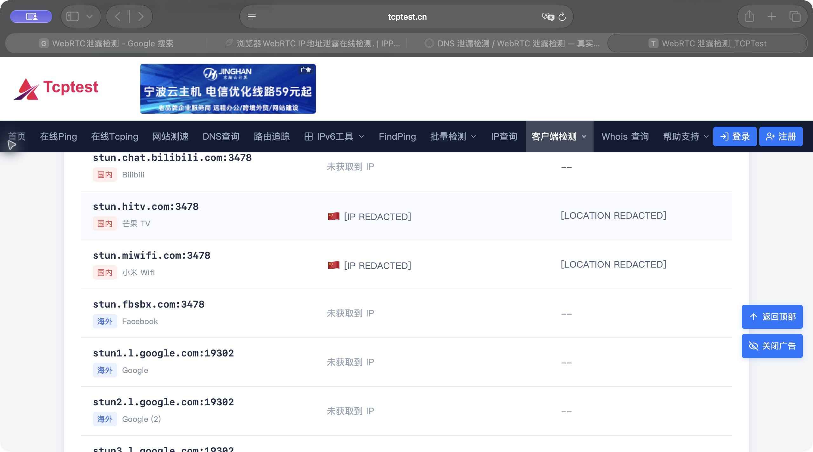
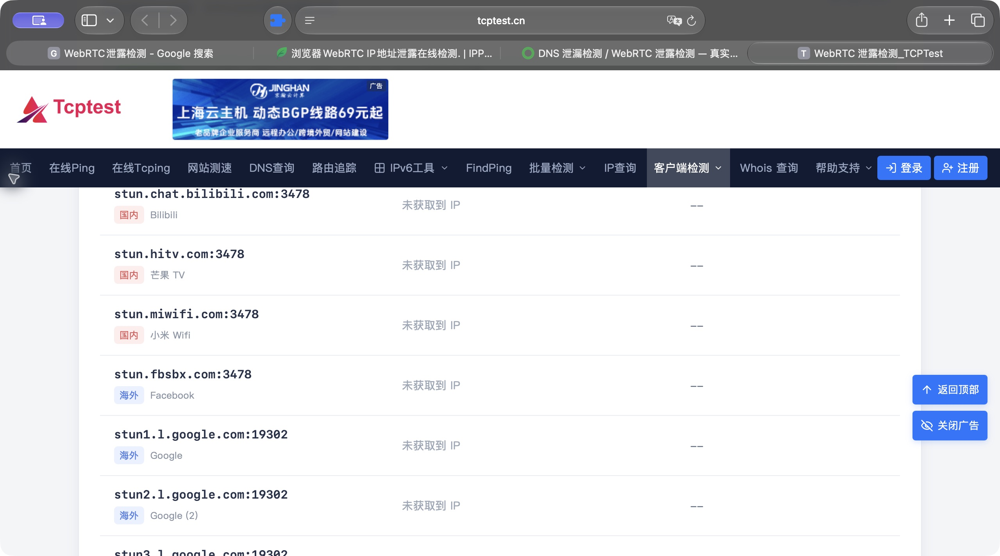

# WebRTC Guard

在获得网站访问权限的 Safari 网页中，阻止创建 WebRTC 连接，减少网页通过 ICE/STUN 获取地址的机会。

**0.1.0 是实验版。** 已通过本机 WebKit 扩展运行时测试、macOS 容器构建，以及 Safari 27.0.1 中 TCPTest 的开启/关闭对比。网页语音、视频会议、远程桌面和点对点文件传输可能无法使用。它无法更改 HTTP 出口，也不能替代正确配置的 VPN。

## 无开发者账号安装（macOS）

推荐使用当前 Safari；开发时验证的版本为 **Safari 27.0.1**。Apple 现在支持直接加载扩展目录或 ZIP，无需 Xcode 和付费开发者账号。较旧 Safari 如果没有“添加临时扩展”按钮，参见下面的 Xcode 路径。

1. 下载本仓库 main 分支源码并找到 `extension` 文件夹。已有 v0.1.0 Release 是改名前的历史版本；后续打包文件使用 `webrtc-guard-版本号.zip`。
2. Safari → 设置 → 高级 → 勾选“显示网页开发者功能”。
3. 设置 → 开发者 → “添加临时扩展…”（Add Temporary Extension），选择 ZIP 或 `extension` 文件夹。根据系统提示，由你确认允许未签名扩展；不要向项目作者提供系统密码。
4. 在设置 → 扩展中启用 **WebRTC Guard**，返回要测试的网页，点击工具栏的扩展拼图按钮，选择“允许1天”或“在此网站上始终允许”。希望应用于日常浏览时，再按需要授权全部网站。
5. **授权后重新加载网页**；现有页面和连接不保证已受保护。

临时扩展在 **退出 Safari 或 24 小时后**移除。“允许未签名扩展”也会在退出 Safari 后重置。重新打开浏览器后需要重新加载，不能把这种安装方式当作持续保护。

无痕浏览、不同 Safari 个人资料的扩展启用和授权须分别确认。遇到网页通话问题，可以禁用扩展或撤销该站权限，然后重新加载网页。扩展已经修改的页面必须重新加载才能恢复原生 API。

[Apple 官方安装说明](https://developer.apple.com/documentation/safariservices/running-your-safari-web-extension)

## 对比验证

1. 保持相同的 VPN/TUN 状态和规则，关闭扩展，打开 [TCPTest WebRTC 检测](https://www.tcptest.cn/webrtc)，私下记录 HTTP 地址及各 STUN 行结果。
2. 启用扩展、授权该网站，重新加载并检测。预期是无法创建 WebRTC 连接，检测站显示不支持、失败或无法取得 WebRTC 地址；不同检测站文案不同。
3. 确认 HTTP 地址仍然可见。**HTTP 与 WebRTC 地址相同只说明两者出口一致**；如果 HTTP 已是原始地址，要另查分流规则、TUN 路由、IPv6 和 UDP。
4. 用另一个检测站交叉核对，例如 [BrowserLeaks WebRTC](https://browserleaks.com/webrtc)。没有候选地址也可能是 STUN 不可达，不能单凭空白结果判定保护成功。
5. 开发者控制台执行 `new RTCPeerConnection()`，应得到包含扩展名的 `SecurityError`。该检查只验证当前页面的入口；不能证明全部网页和网络路径安全。
6. 关闭扩展并重新加载，再测一次，验证 WebRTC 功能恢复。分享反馈前隐藏 IP、位置、代理节点和浏览记录。

### Safari 实测截图

2026-10-11，Safari 27.0.1。在同一检测页上，关闭扩展时芒果 TV、小米 WiFi 的 STUN 行取得地址；开启时所有 STUN 行显示“未获取到 IP”，控制台创建连接得到扩展的 `SecurityError`。关闭后原生连接可创建，再次开启后拦截恢复。Bilibili 的 STUN 行在部分关闭状态测试中也取得地址，截图这一轮未取得。

截图前仅在网页显示层将 IP 和地理位置替换为遮挡标记，检测结果文字保持原样。

| 关闭扩展 | 开启扩展 |
| --- | --- |
|  |  |

该站在所有 STUN 行都为空时，顶部仍显示“HTTP / WebRTC”及“未检测到泄露”。此时应结合 STUN 行和控制台拦截错误判断；顶部显示的 HTTP 地址仍是网站正常请求可见的出口地址。

## 保护范围

- 在 `document_start` 同步运行于网页 `MAIN` world，拦截 `RTCPeerConnection` 及已有的旧名称；不保存原生构造器或暴露其 prototype。
- 请求对匹配的 HTTP/HTTPS 页面及 iframe 注入，包括可匹配的 about:blank/srcdoc/blob 等来源回退场景。具体覆盖仍受 Safari 的权限和注入规则限制。
- 无后台脚本、统计上报、远程代码、网络请求、地址采集或持久存储。详见 [隐私说明](PRIVACY.md)。
- 这是网页 JavaScript 层的防护，**没有禁用 Safari 引擎或系统 UDP**。未授权页面、浏览器限制页面、注入前已保存的原生引用、已经创建的连接，以及未被注入的执行环境都不在保证范围内。
- 不能保证对抗所有主动绕过，包括从其他执行环境取得原生 API。第一版不会以“零泄露”或“保留 WebRTC 通话且隐藏真实 IP”的名义发布。

## 开发和检查

没有第三方运行依赖：

```sh
npm test
npm run package
```

本机 macOS 15.4+、完整 Xcode 下运行真正的 WebKit 扩展测试：

```sh
python3 scripts/test-webkit.py
```

该测试在独立临时 WebKit 数据环境中加载实际 `manifest.json`，比较未加载、未授权、已授权三种情况；只访问随机本机端口，不使用 STUN，不修改 Safari 设置，结束后清理服务器与临时文件。它不等同于 Safari 应用内的安装验证。

### Xcode 容器路径

```sh
sh scripts/build-macos.sh
```

脚本构建仓库中的 `native/WebRTC Guard/WebRTC Guard.xcodeproj`，得到未签名的 macOS 容器。直接用 Xcode 打开该工程，选择 **WebRTC Guard → My Mac**，即可构建、运行和修改容器；原生代码及共享 Scheme 已纳入版本管理。扩展目标的 Resources 直接引用仓库 `extension` 目录，不需要复制 JavaScript。

现有 Bundle Identifier 保留原值，以维持安装身份；显示名称和产品名称统一为 WebRTC Guard。GitHub 仓库仍叫 `safari-webrtc-guard`。当前实现已验证 Safari，其他浏览器的适配与验证将在后续开展。

首次生成工程时，Xcode 打包工具对 `world`、`match_about_blank`、`match_origin_as_fallback` 发出兼容性警告；实际本机 WebKit 运行时已验证这些场景，其他版本须实测。

后续 App Store 发布需要 Apple Developer Program、配置签名、正式图标与容器界面、隐私信息，并完成 Safari 实机兼容性测试及审核。详见 [Apple 打包说明](https://developer.apple.com/documentation/safariservices/packaging-a-web-extension-for-safari)与[分发说明](https://developer.apple.com/documentation/safariservices/distributing-your-safari-web-extension)。

## 研究与验证记录

[现有项目及 Safari 能力调查](docs/research.md) · [验证记录](docs/validation.md)

MIT License。源码独立编写；调查项目只作为行为和兼容性参考。
