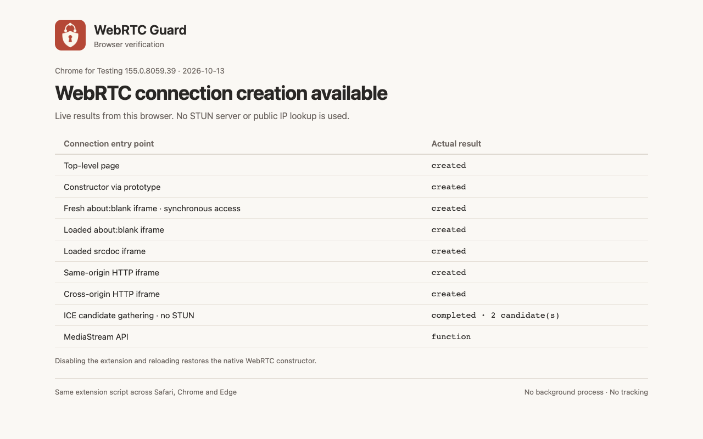
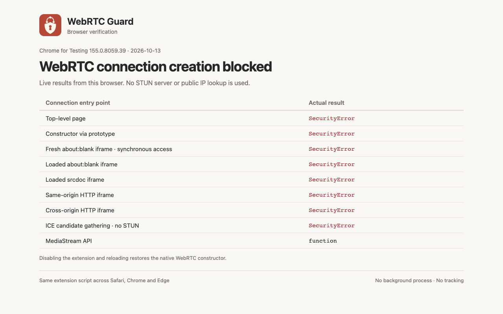
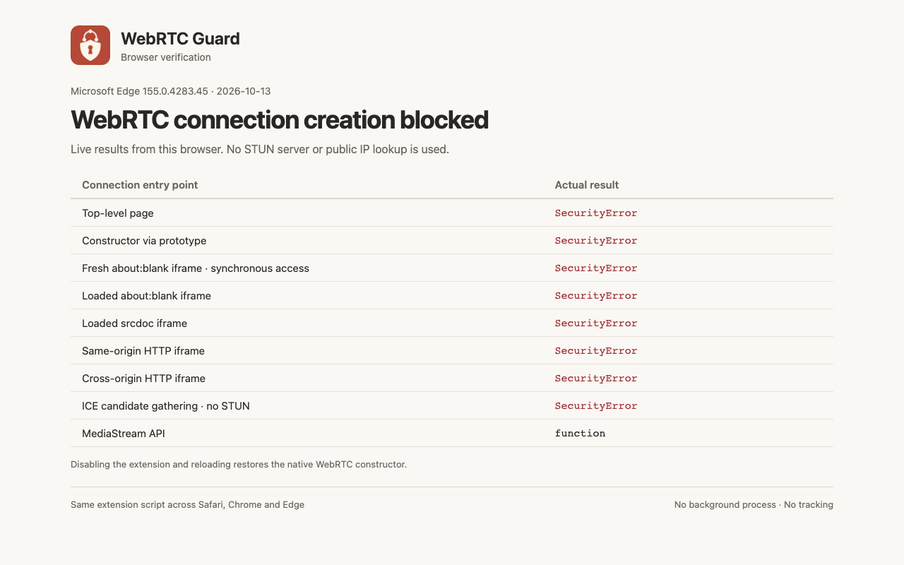

# WebRTC Guard


简体中文 · [English](README.en.md)

[](https://github.com/polang233/safari-webrtc-guard/actions/workflows/test.yml)
[](LICENSE)


轻量的 WebRTC 拦截扩展。在获得网站权限的页面中阻止创建 WebRTC 连接，减少网页通过 ICE/STUN 暴露 IP 的机会。

一个约 30 行的脚本，无后台进程、网络请求或第三方运行依赖。网站开关使用浏览器自带的扩展权限。**已授权网站的网页语音／视频通话、远程桌面和点对点传输也会被阻止。**

## 浏览器支持

|  Safari |  Chrome |  Microsoft Edge |
| :---: | :---: | :---: |
| macOS · Safari 18.4+ | 桌面版 · Chromium 119+ | 桌面版 · Chromium 119+ |
| 临时扩展 / Xcode 容器 | 开发者模式安装 | 开发者模式安装 |

Chrome Web Store 和 Microsoft Edge Add-ons 版本正在准备。当前可从源码构建安装；Safari 已发布的 ZIP 可在 [Releases](https://github.com/polang233/safari-webrtc-guard/releases) 下载。最低版本依据清单能力要求，已测试版本见[验证记录](docs/validation.md)。

## 安装

### Chrome / Edge

1. 下载或克隆源码，在项目目录执行 `python3 scripts/package.py`，只需要 Python 3。已有 Node.js 时也可执行 `npm run package`，无需安装依赖。
2. Chrome 打开 `chrome://extensions`；Edge 打开 `edge://extensions`，启用**开发者模式**。
3. 点击**加载已解压的扩展**，选择生成的 `dist/chromium` 文件夹。也可解压 `dist/webrtc-guard-chromium-1.1.0.zip` 后选择其中包含 `manifest.json` 的文件夹。
4. 在扩展详情的**网站访问权限**中选择允许的网站，然后**重新加载网页**。

允许访问全部网站时，扩展会在普通 HTTP/HTTPS 网页中自动拦截。某个网站需要通话时，撤销该站的访问权限或临时关闭扩展，再重新加载。无痕／InPrivate 需在扩展详情中单独允许。

### Safari

1. 下载 Safari 版本 ZIP，或执行 `npm run package` 生成 `dist/webrtc-guard-1.1.0.zip`。
2. Safari → 设置 → 高级，勾选**显示网页开发者功能**。
3. 设置 → 开发者 → **添加临时扩展…**，选择 ZIP，按系统提示允许未签名扩展。
4. 设置 → 扩展中启用 **WebRTC Guard**，为网站授权，然后**重新加载网页**。

临时扩展在退出 Safari 或 24 小时后移除，需要重新添加和授权。不同个人资料及无痕浏览需分别启用。

<details>
<summary>Safari：用 Xcode 自己构建</summary>

打开 `native/WebRTC Guard/WebRTC Guard.xcodeproj`，选择 **WebRTC Guard → My Mac**，点击运行。Safari 的开发者设置中勾选**允许未签名的扩展**，再到扩展设置中启用和授权。

按 [Apple 官方说明](https://developer.apple.com/documentation/safariservices/running-your-safari-web-extension)，通过 Xcode 运行容器安装的扩展不受临时 ZIP 的 24 小时限制，但“允许未签名的扩展”在退出 Safari 后会重置。本项目已验证不选 Team 的 ad-hoc 构建和系统识别；该路线在 Safari 内的完整启用、拦截和重启流程仍待实测。长期签名分发需要相应 Apple 开发者账号。

</details>

## 实际效果

以下是实际加载扩展 ZIP 后的检测结果。Chrome for Testing 155.0.8059.39 和 Edge 155.0.4283.45 的本机检测页不查询公网 IP；Safari 的 TCPTest 截图已遮挡 IP 和位置，检测结果保持原样。

| Chrome · 关闭 | Chrome · 开启 |
| --- | --- |
|  |  |

| Edge · 关闭 | Edge · 开启 |
| --- | --- |
|  |  |

<details>
<summary>Safari · TCPTest 实机对比</summary>

| 关闭 | 开启 |
| --- | --- |
|  |  |

</details>

开启并重新加载后，在网页开发者控制台执行 `new RTCPeerConnection()`，预期得到 `SecurityError: WebRTC connection blocked by WebRTC Guard.`。可在 [BrowserLeaks](https://browserleaks.com/webrtc) 或 [TCPTest](https://www.tcptest.cn/webrtc) 进行开启／关闭对比；只看到空白 STUN 结果不足以证明拦截生效。

## 保护范围

这是网页 JavaScript 层的防护，不会关闭浏览器的 WebRTC 引擎或系统 UDP。未授权的网站、浏览器内部页面、已建立的连接和注入前保存的原生构造器不受保证。新建 iframe 的同步访问等绕过路径须结合[验证记录](docs/validation.md)评估，不能保证阻止所有主动绕过。

扩展不改变网站正常 HTTP 请求的出口地址，也不能替代正确配置的 VPN。扩展不收集数据，详见[隐私说明](PRIVACY.md)。

## 开发与打包

```sh
npm test                         # 无第三方依赖的 Node 单元测试
npm run package                  # Safari ZIP + Chrome/Edge ZIP 与解压目录
npm ci                           # 安装仅供开发验证的 Playwright
npx playwright install chromium  # 安装测试浏览器
npm run test:browsers             # 真实 Chromium 扩展加载、拦截与恢复
npm run test:browsers -- --edge    # 已安装的 Microsoft Edge
python3 scripts/test-webkit.py    # macOS 上的真实 WKWebExtension 测试
sh scripts/build-macos.sh        # Safari 容器构建
```

`extension/guard.js` 是三个浏览器共用的实现；Safari 工程直接引用 `extension/`，Chrome / Edge 由打包脚本生成兼容清单和中英文元数据。测试截图和结果输出到 `output/playwright/`。商店包、说明文案与截图要求见[商店发布资料](docs/store-listing.md)。

[MIT](LICENSE)
